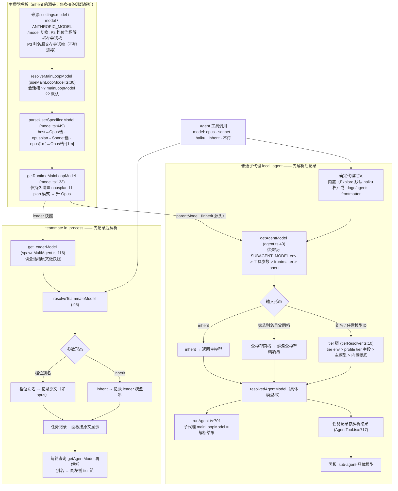

# Doge Code 子代理与 Agent-Teams 模型选择机制梳理

> 只读分析报告 · 2026-10-19 · 基于当前 main 分支代码逐行核实，所有结论附 `file:line`。
> 背景：本仓库（Doge Code）内部始终使用 Anthropic Messages 格式，多 provider 转换只发生在 API 边界；
> 本报告只覆盖"模型名如何被选择、解析、记录、显示"，不覆盖协议转换本身。

## 一、TL;DR

1. **Agent 工具的 `model` 参数被 schema 写死为 4 个值**：`opus` / `sonnet` / `haiku` / `inherit`（可不传），见 `src/tools/AgentTool/AgentTool.tsx:101` 的 `z.enum`。
2. **普通子代理（local_agent）是"先解析后记录"**：spawn 前就把别名解析成具体模型串，任务记录与面板显示的是解析结果。
3. **Teammate（in_process_teammate）是"先记录后解析"**：任务记录存原始参数（别名原样 / inherit 已替换为 leader 模型串），面板显示原文；真实模型在每轮查询时才解析。
4. `best` / `opusplan` / `opus[1m]` 等扩展别名是**主模型层**的语法糖，Agent 工具参数传不进来，只在 `/model`、`--model`、settings、frontmatter 等入口生效。
5. **档位只决定"模型名"，不决定"端点"**：任何档位解析出的模型都从当前激活连接（baseURL/provider env）发出，没有独立的"官方 Opus 通道"。

## 二、术语与角色

| 术语 | 含义 |
|---|---|
| leader / 主模型 | 发起 Agent 调用的会话所用的模型，`inherit` 的源头 |
| 普通子代理 (local_agent) | Agent 工具起的同步/后台任务型子代理，跑完即止 |
| teammate (in_process_teammate) | agent-teams 里长驻的队友，`team_name + name` 方式拉起 |
| 档位别名（家族别名） | `opus` / `sonnet` / `haiku`（`MODEL_FAMILY_ALIASES`，`src/utils/model/aliases.ts:24`） |
| 扩展别名 | `best` / `opusplan` / `opus[1m]` 等 10 个（`MODEL_ALIASES`，`aliases.ts:1-12`） |
| tier 链 | 档位 → 具体模型 的解析链，见 §五 |

## 三、主模型（leader）解析链 —— `inherit` 的源头

### 3.1 来源优先级（`getUserSpecifiedModelSetting`，`src/utils/model/model.ts:65-81`）

```
会话内 override（setMainLoopModelOverride，global 域 /model 或 bridge 写入）
> ANTHROPIC_MODEL env
> settings.json 的 model 字段
> （都无）内置默认
```

注意：交互式 REPL 的实际取值走 `resolveMainLoopModel`（`src/hooks/useMainLoopModel.ts:30-41`）：
`AppState.mainLoopModelForSession（会话槽） ?? AppState.mainLoopModel ?? 默认`，然后**每条查询现场解析别名**。

### 3.2 `/model` 命令的三路分派（`decideAndSwitch`，`src/commands/model/handlers.ts:51-78`）

| 分支 | 触发条件 | 行为 | 会话槽存什么 |
|---|---|---|---|
| P1 | 匹配已存 profile | `switchModelProfileAtomic`（切连接 env + 五步原子切换） | `profile.model`（`switchModelProfile.ts:249`） |
| P2 | `opus`/`sonnet`/`haiku`（仅这三个家族别名，`handlers.ts:33`） | `switchTier`，**当场解析** | 解析后的具体模型（`switchModelProfile.ts:309`） |
| P3 | 其它任意字符串 | **只写会话槽，不切连接** | 原文（如 `glm-5.3-flash[1m]`、`best`、`opusplan`） |

推论与坑：
- `best` / `opusplan` / `opus[1m]` **不在 P2 集合**，走 P3 原文入槽，每次查询由 `resolveMainLoopModel` → `parseUserSpecifiedModel` 现场翻译。
- P3 不切连接：`/model <裸模型名>` 只改模型名，请求仍发往原端点（"半切换"状态）。
- `opusplan` 的 Plan 模式升 Opus（`getRuntimeMainLoopModel`，`model.ts:140-147`）条件是
  `getUserSpecifiedModelSetting() === 'opusplan'`——该函数**不读会话槽**（`model.ts:65-81`），
  所以**会话级 `/model opusplan` 永远只有 Sonnet**；只有 `--model opusplan` / settings 持久化才有完整行为。

### 3.3 别名翻译表（`parseUserSpecifiedModel`，`model.ts:449-524`）

| 输入 | 翻译结果 | 备注 |
|---|---|---|
| `opus` / `sonnet` / `haiku` | `getDefaultOpus/Sonnet/HaikuModel()` + 回贴 `[1m]/[2m]` | tier 链见 §五 |
| `best` | `getBestModel()` = Opus 档默认（`model.ts:103-105,480`） | 与 `opus` 实质等价；**不回贴后缀**（`best[1m]` 会静默丢 1M） |
| `opusplan` | `getDefaultSonnetModel()` | Plan 升 Opus 是另一机制（§3.2） |
| `opus[1m]` 等 | 对应档默认 + `[1m]` | 后缀只影响本地上下文窗口计算（`src/utils/context.ts`）与计费展示，API 请求剥掉不发 |
| 任意其它串 | 原样透传（仅剥/回贴后缀） | 保留大小写，适配自定义部署名 |

`/model` 选择器本身就把这些别名作为 value 写入（`src/utils/model/modelOptions.ts:267,276,307`），是扩展别名的主要来源。

## 四、普通子代理（local_agent）—— 先解析后记录

### 4.1 调用链

```
Agent 工具调用（schema: AgentTool.tsx:101，model ∈ 4 值或不传）
→ 确定代理定义：内置（general-purpose/Plan=inherit，Explore 非 ant 默认 haiku 档，
   exploreAgent.ts:78）或 .doge/agents/*.md frontmatter（model 可写任意串，loadAgentsDir.ts:572）
→ AgentTool.tsx:435  getAgentModel(...) → resolvedAgentModel   【spawn 前解析】
→ AgentTool.tsx:717/858  任务记录 model = resolvedAgentModel    【存解析结果】
→ runAgent.ts:362-367（再次解析或复用 override）→ runAgent.ts:701
   子代理自己的 context.options.mainLoopModel = 解析结果 → queryModel 管道
```

### 4.2 `getAgentModel` 的优先级与分支（`src/utils/model/agent.ts:40-109`）

```
1. CLAUDE_CODE_SUBAGENT_MODEL env（非 'inherit' 时最高，可覆盖工具参数，agent.ts:51-54）
2. 工具 model 参数（agent.ts:84-90）
   - 'inherit' 视同"未指定"，落到 3
   - 家族别名且父模型同档（aliasMatchesParentTier，agent.ts:124-136）→ 直接继承父模型精确串
   - 否则 parseUserSpecifiedModel（任意别名/模型 ID 都在这翻译）
3. 代理定义 frontmatter model（agent.ts:92）
4. 都没有 → 默认 'inherit'（getDefaultSubagentModel，agent.ts:28-30）
   → getRuntimeMainLoopModel({ mainLoopModel: 父模型 }) 原样返回父模型（agent.ts:94-102）
     （附带效果：leader 持久 opusplan 进 Plan 模式时，inherit 子代理一并拿到 Opus）
```

### 4.3 记录与显示

- 任务记录存**解析后**的具体模型串（`AgentTool.tsx:717/858`）。
- 面板行显示 `sub-agent-<模型名>`（剥 `[1m]` 后缀，`CoordinatorAgentStatus.tsx:87` + `shortModelName.ts`）。
- 例：glm profile 激活时传 `model: "haiku"` → 解析为 `glm-5.3-flash[1m]` → 面板显示 `glm-5.3-flash`，别名不可见。

## 五、Agent-Teams（teammate）—— 先记录后解析

### 5.1 spawn 链

```
Agent 工具（team_name + name）
→ getLeaderModel(getAppState())   读 leader 有效模型快照
   = mainLoopModelForSession(原文) ?? mainLoopModel ?? 默认
   （spawnMultiAgent.ts:116-122；注释明确这是修过"读到旧全局模型"bug 的统一入口）
→ resolveTeammateModel(参数, leaderModel)   (spawnMultiAgent.ts:95-103)
   - 'inherit' → 返回 leaderModel（此时已替换为具体模型串）
   - 其它（含档位别名）→ 原样返回，不做任何解析
→ spawnInProcessTeammate：taskState.model = 上一步结果   (spawnInProcess.ts:157-191)
```

### 5.2 每轮查询时的真实解析

```
inProcessRunner.ts:1258-1286  runAgent({ model: 记录值 })
→ runAgent.ts:362-367  getAgentModel(frontmatter, options.mainLoopModel, 记录值)
   - 记录值 = 'opus' 等别名 → 此时才按 tier 链解析成具体模型
   - 记录值 = 具体模型串（inherit 替换过）→ parseUserSpecifiedModel 透传
```

### 5.3 记录与显示（与普通子代理的关键差异）

| | 普通子代理 | teammate |
|---|---|---|
| 任务记录内容 | 解析后的具体模型 | 原始参数（别名原样 / inherit 已替换） |
| 面板显示 | `sub-agent-<具体模型>` | `<名字>-<原文>`：传别名显示 `opus` 等字样，传 inherit 显示实际模型名 |
| 解析时机 | spawn 前一次 | spawn 记录 + 每轮查询各一次 |

推论：teammate 面板的 `opus` 标签**不代表实际模型**——在多 provider 环境下标签与实际运行模型可能完全不同（本次 402 事故的直接困惑来源）。

## 六、tier 链（档位 → 具体模型）

`resolveDefaultTier`（`model.ts:108-126`）+ `resolveTierModel`（`src/utils/model/tierResolver.ts:10-21`）：

```
ANTHROPIC_DEFAULT_OPUS/SONNET/HAIKU_MODEL env
> 激活 profile 的 defaultOpus/Sonnet/HaikuModel 字段（随 profile 切换经 modelProfileEnvPatch 注入 env）
> 主模型（非别名时）
> 内置兜底名单（官方 Claude 型号串，getModelStrings()）
```

要点：**档位只决定模型名，端点仍是当前激活连接**。三个档位可以指向同一个模型（如 deepseek profile 三档全是
`deepseek-flash[1m]`）——"起 opus 档"不等于"有一条官方 Opus 通道"。

## 七、案例复盘：4 个子代理 402 团灭

1. 会话启动时激活 deepseek profile（openai 协议，`api.deepseek.com`）。
2. 4 个子代理以 `model: "opus"/"sonnet"` 拉起 → tier 链解析到 profile 的
   `defaultOpus/SonnetModel = deepseek-flash[1m]` → 仍发往 deepseek 端点。
3. 该账户余额不足 → 全员 `402 Insufficient Balance`。
4. 面板显示 `opus`/`sonnet` 标签（teammate 原样记录），与实际模型脱节，加重排查困惑。

## 八、已知不一致与弱点清单（本次核实）

| # | 问题 | 位置 | 影响 |
|---|---|---|---|
| 1 | teammate 面板显示别名原文，与实际运行模型脱节 | `spawnMultiAgent.ts:99-102` | 多 provider 下误导排查 |
| 2 | 普通子代理与 teammate 记录时机不一致（先解析 vs 先记录） | `AgentTool.tsx:717` vs `spawnInProcess.ts:168` | 同类参数两种显示语义 |
| 3 | 会话级 `/model opusplan` 无 Plan 模式 Opus 升级 | `model.ts:140-147` 依赖 `getUserSpecifiedModelSetting()`（不读会话槽） | 行为与用户预期不符 |
| 4 | `/model <裸模型名>`（P3）只改模型名不切连接 | `handlers.ts:70-77` | "半切换"，请求发往旧端点 |
| 5 | `CLAUDE_CODE_SUBAGENT_MODEL` 压过工具参数，与 `agent.ts:78-84` 注释冲突 | `agent.ts:51-54` | 排障时易忽略 env 覆盖 |
| 6 | `best` 不回贴 `[1m]` 后缀：`best[1m]` 静默丢 1M | `model.ts:480` | 上下文窗口意外回落 200k |
| 7 | tmux teammate env 白名单缺 tier/effort/subagent 模型变量 | `spawnUtils.ts:13-62` | tmux 队友档位行为可能与 lead 漂移 |
| 8 | P3 会话槽原文可被后续 P1 profile 切换覆盖为 `profile.model` | `switchModelProfile.ts:249` | spawn 快照可能落在与预期不同的基线模型上 |

## 九、调用与解析链总图



## 十、关键文件索引

| 文件 | 职责 |
|---|---|
| `src/tools/AgentTool/AgentTool.tsx` | 工具 schema（:101 enum）、spawn 前解析（:435）、任务记录（:717/858） |
| `src/utils/model/agent.ts` | `getAgentModel` 核心（:40-109）、默认值（:28）、别名同档继承（:124） |
| `src/utils/model/model.ts` | 主模型来源（:65-101）、档位默认（:108-126）、运行时升级（:133-155）、别名翻译（:449-524） |
| `src/utils/model/aliases.ts` | `MODEL_ALIASES`（:1-12）、家族别名（:24） |
| `src/utils/model/tierResolver.ts` | tier 链（:10-21） |
| `src/commands/model/handlers.ts` | `/model` P1/P2/P3 分派（:51-78） |
| `src/utils/model/switchModelProfile.ts` | profile 原子切换（:219-274）、switchTier（:304-329） |
| `src/tools/shared/spawnMultiAgent.ts` | `resolveTeammateModel`（:95）、`getLeaderModel`（:116）、teammate spawn（:900） |
| `src/utils/swarm/spawnInProcess.ts` | teammate 任务记录（:157-191） |
| `src/utils/swarm/inProcessRunner.ts` | teammate 主循环、每轮再解析（:1258-1286） |
| `src/tools/AgentTool/runAgent.ts` | 子代理运行时解析（:362）、自身 mainLoopModel（:701） |
| `src/hooks/useMainLoopModel.ts` | REPL 主模型统一解析（:30-41） |
| `src/components/tasks/shortModelName.ts` | 面板模型名展示（剥 `[1m]`） |
